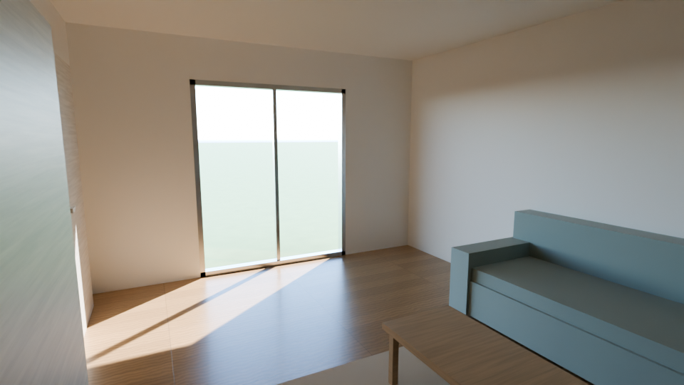

# blender-realism

Blender に読み込んだ家・部屋のモデルを、1回の実行で写真に近い見た目にするスクリプトです。



上の画像は、箱を並べただけのテスト用の部屋（cm 単位の .glb）にこのスクリプトを実行して Cycles で描いたものです（CPU・960×540・200 サンプル）。

## やること

| 項目 | 内容 |
|---|---|
| 単位 | モデルの大きさから mm / cm / m を判定して m にそろえる |
| レンダー | Cycles・GPU 自動選択（OptiX → CUDA → CPU）・ノイズ除去・AgX の色 |
| 光 | 物理ベースの空と、時刻・方角から決めた太陽。ガラスが日差しをさえぎらないよう設定 |
| 明るさ | カメラが室内なら露出 +2.5、外観なら 0 を自動で設定 |
| 材質 | オブジェクト名・マテリアル名から推測して付け替え（下の表）。元の色は生かす |
| 面取り | 家具などの角に 3mm の丸みを付ける |
| 地面・カメラ | 地面がなければ追加。カメラがなければ室内（目線 160cm・いちばん大きい窓に向ける）と外観の 2 台を作る |

何度実行しても大丈夫です。自動で作ったものは名前が `AUTO_` で始まり、実行のたびに作り直します。元のマテリアルは消しません。

## 必要なもの

- Blender 4.2 以降（5.2 で動作確認済み）
- モデルの形式: .blend / .glb / .gltf / .obj / .fbx / .stl / .ply / .usd / .dxf
- DXF のときだけ: Python 3.9 以降と ezdxf（下の「DXF の場合」）

## 使い方（Windows）

### 1. スクリプトをモデルのフォルダに置く

PowerShell で（`make_realistic.py` と、DXF 用の `dxf2obj.py` の 2 つを保存します）:

```powershell
foreach ($f in "make_realistic.py", "dxf2obj.py") { Invoke-WebRequest -Uri "https://raw.githubusercontent.com/masahiroc1203-ctrl/masahiro/claude/determined-lamport-q4ahej/blender-realism/$f" -OutFile "C:\dev\house-3d-model\$f" }
```

### 2-A. Blender の画面から使う

1. Blender でモデルを開く（.blend 以外は「ファイル → インポート」）
2. 上のタブ「Scripting」→ テキストエディタの「開く」で `make_realistic.py` を選ぶ
3. ▶ ボタン（または Alt+P）で実行
4. F12 でレンダリング

結果の説明はテキストエディタの「REALISM_REPORT」に出ます。設定を変えるときは、ファイル冒頭の `SETTINGS` を書き換えて、もう一度実行します。

### 2-B. コマンドで使う（画面を開かずに画像を作る）

```powershell
$blender = (Get-ChildItem "C:\Program Files\Blender Foundation\*\blender.exe" | Select-Object -Last 1).FullName
```

```powershell
& $blender -b -P "C:\dev\house-3d-model\make_realistic.py" -- --model "C:\dev\house-3d-model\モデルのファイル名.glb" --render "C:\dev\house-3d-model\render.png" --preview
```

`--preview` は下書き（64 サンプル・半分の解像度）です。仕上がりを確かめたら外して本番の画質で描きます。.blend のときは `& $blender -b "house.blend" -P make_realistic.py -- --render out.png` の形でも使えます。

主なオプション:

| オプション | 意味 | 例 |
|---|---|---|
| `--time` | 太陽の時刻（6〜18） | `--time 10` |
| `--south` | モデルの南の向き | `--south +Y` |
| `--camera` | `auto` / `interior` / `exterior` / `keep` | `--camera exterior` |
| `--exposure` | 明るさ（+1 で 2 倍） | `--exposure 3` |
| `--samples` | 画質（多いほどきれいで遅い） | `--samples 512` |
| `--res` | 解像度 | `--res 2560x1440` |
| `--unit-scale` | 単位の判定を上書き（cm なら 0.01） | `--unit-scale 0.01` |
| `--hdri` | 背景に HDRI 画像を使う | `--hdri sky.exr` |
| `--save` | 設定後の .blend を保存 | `--save house_real.blend` |
| `--no-materials` / `--no-bevel` | 材質の付け替え・面取りをしない | |

## DXF の場合

Blender は DXF をそのまま読めないので、`dxf2obj.py` が DXF を OBJ に変換してから読み込みます。`--model` に .dxf を渡せば自動で変換されます。DXF のレイヤーがそのまま Blender の物体名になるので、レイヤー名に「壁」「床」「窓」などが入っていれば材質も自動で付きます。

1. Python に ezdxf を入れる（最初の 1 回だけ。Python がなければ python.org から入れる）

```powershell
py -m pip install ezdxf
```

2. まず変換だけ試して、中身を確かめる（単位・レイヤー・3D か 2D か が表示されます）

```powershell
py "C:\dev\house-3d-model\dxf2obj.py" "C:\dev\house-3d-model\ファイル名.dxf"
```

3. Blender で描く

```powershell
& $blender -b -P "C:\dev\house-3d-model\make_realistic.py" -- --model "C:\dev\house-3d-model\ファイル名.dxf" --render "C:\dev\house-3d-model\render.png" --preview
```

Blender の画面から使うときは、`SETTINGS` の `MODEL_PATH` に .dxf のパスを書いて ▶ で実行します。

| DXF の中身 | 扱い |
|---|---|
| 3DFACE・ポリフェースメッシュ・MESH・厚さ付きの SOLID | そのまま面になる |
| ブロック（INSERT） | 展開する。ブロック内のレイヤー 0 の図形は INSERT のレイヤーに入る |
| 厚さ（thickness）付きの線・ポリライン・円 | 縦の面になる |
| 2D の図面（閉じたポリライン・HATCH） | `--dxf-extrude "壁=2400,床=0"` で指定したレイヤーを立ち上げる（高さ mm。内側の輪郭は穴になる。`=0` は平らな面） |
| 3DSOLID・BODY・REGION（ACIS 形式） | 変換できない。CAD で「分解（EXPLODE）」するか、STL・メッシュで書き出す |
| 寸法・文字・線だけの図形 | 無視する |

単位は DXF の設定（$INSUNITS）を見て m に直します。設定がない図面は、Blender 側で大きさから mm / cm / m を判定します。DXF の線の色は、ふつう材質の色ではないので使いません（使うときは `--dxf-colors`）。

## 材質が自動で付く名前

オブジェクト名かマテリアル名（DXF ならレイヤー名）に次の言葉が入っていると、その材質になります（大文字小文字は区別しません）。上から順に判定するので、`Window_Frame` は「金属」、`Window_Glass` は「ガラス」になります。

| 材質 | 名前に含む言葉（一部） |
|---|---|
| 金属 | frame, sash, handle, metal, 枠, サッシ, 取っ手, アルミ |
| ガラス | glass, window, glaz, 窓, ガラス |
| 床（フローリング） | floor, flor, slab, 床, フローリング |
| 壁（しっくい） / 天井 | wall, 壁, クロス / ceiling, clng, 天井 |
| 木 | wood, table, desk, shelf, door, furn, 木, テーブル, 棚, ドア, 家具, 柱, 梁, ボード |
| 布 | sofa, curtain, bed, rug, ソファ, カーテン, ベッド, ラグ |
| タイル | tile, bath, タイル, 浴室 |
| 屋根・コンクリート・地面 | roof, 屋根 / concrete, 基礎 / ground, grass, 庭, 芝 |
| 植物・樹脂 | plant, leaf, 植物 / tv, テレビ, plastic |

名前から判断できなかったものは、そのまま残してレポートに一覧を出します。照明（lamp, light, 照明）と、画像テクスチャ付きのマテリアルには手を付けません。

## うまくいかないとき

- **暗い・明るすぎる**: `--exposure` で調整（室内は 2〜4 くらい）。日差しを強くするなら `SUN_STRENGTH`、部屋全体を明るくするなら `SKY_STRENGTH` を上げる
- **大きさがおかしい**（家が小人サイズ・巨大）: `--unit-scale` で単位を指定（mm なら 0.001、cm なら 0.01、m なら 1）
- **日差しが入ってこない**: `--south` を実際の南の向きに合わせる。窓の外に壁や屋根があると光は入りません
- **材質が付かない**: オブジェクト名（DXF ならレイヤー名）を上の表の言葉を含む名前に変える（例: `Cube.012` → `Floor_LDK`）
- **DXF で「面が 1 つもありません」**: 2D の図面です。表示されたレイヤー名を使って `--dxf-extrude "壁=2400,床=0"` を付ける
- **DXF で「ezdxf の入った Python が見つかりません」**: `py -m pip install ezdxf` を実行する。Python の場所を指定するなら `--python "C:\...\python.exe"`
- **GPU が使われない**: Blender の「編集 → プリファレンス → システム → Cycles レンダーデバイス」で OptiX か CUDA を選ぶ。GTX 1660 Ti はどちらにも対応しています
