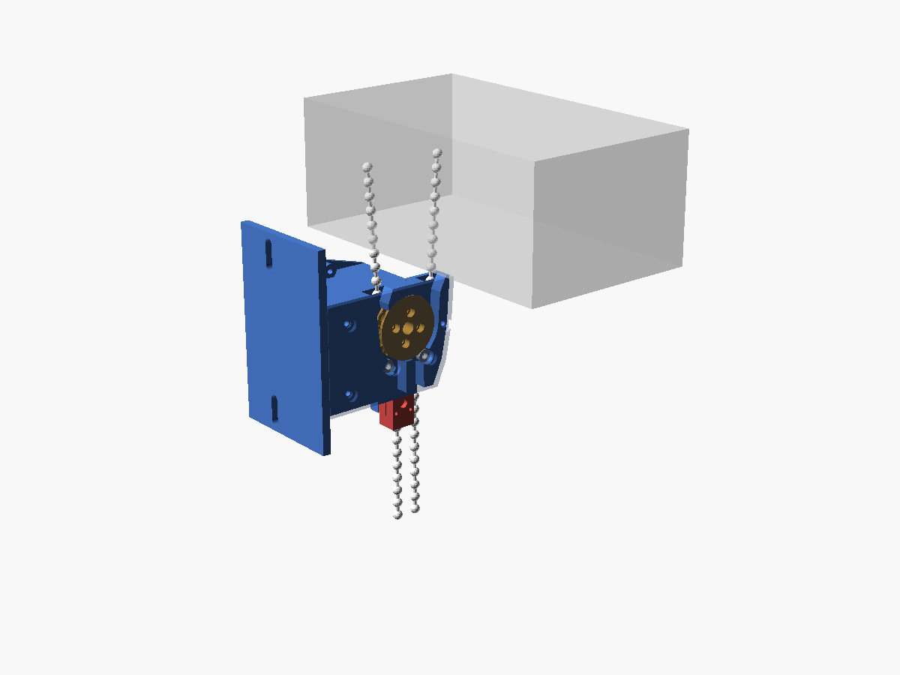

# ロールカーテン自動巻き取り機

既製のチェーン式ロールスクリーン（幅 1.8 m × 高さ 2.0 m）のボールチェーンを、STS3215 で引いて自動で昇降させる後付けユニット。
**ロールの直下**に付け、ヘッドから垂れる 2 本のチェーンの間にスプロケットを入れてかみ合わせる。下のループはそのまま垂れているので、これまでどおり手でも巻き取れる。



## 決めたこと

| 項目 | 内容 |
|---|---|
| モーター | Feetech STS3215-C001（7.4 V、19.5 kg·cm、1:345）。手で回す重さによって C046（1:147）を検討 |
| マイコン / 電源 | ESP32 / AC アダプタ 7.5 V 3 A の 1 系統 |
| カーテン | 幅 1.8 m × 高さ 2.0 m、吊り下げ 約 1.7 kg |
| 取付位置 | **ロール直下**（ヘッドボックスの下 約 30 mm）。サーボは窓の外側、スクリーン側にはカバー 3 mm のみ |
| 駆動 | 2 本のチェーンの間に **14 歯スプロケット**（PCD 27 mm）。各チェーンを外側の**ピンチローラー（MR63ZZ）**で押し付けて約 53° 巻き掛ける |
| チェーン | つなぎ目のない連続ループ（逃げ溝なし） |
| 手での操作 | ユニットを付けたまま、手前を引けば上がり奥を引けば下がる |
| 原位置 | **巻き上げてストップする位置**。奥のチェーンの上限ストッパーがユニット下面に当たり、ホール IC で検出（手で巻き上げても検出できる） |
| 下限 | 手前のチェーンの下限ストッパー + ホール IC（逆巻き防止） |
| 性能（推定） | 設計トルク 4.0 kg·cm（ストールの 20%）、全行程 約 41 秒 |

## ドキュメント

- [docs/mechanical_design.md](docs/mechanical_design.md)：メカ設計書 v2（方式・負荷・スプロケット・ローラー・ハウジング・原位置・手での操作・制御への引き継ぎ・安全・未決事項）
- [docs/build_and_test.md](docs/build_and_test.md)：実測チェックリスト、部品表、配線、組立・設置、試験手順

## ファイル

```
roll-curtain-winder/
├── calc/winder_calc.py   負荷・巻き掛け・トルク・手で引く力の計算（実測値で再計算できる）
├── cad/winder.scad       パラメトリック CAD（OpenSCAD）
├── cad/build.sh          STL と画像の再生成
├── cad/stl/              3D プリント用 STL（sprocket / housing / cover / cap / stopper）
└── cad/images/           組立図・断面図
```

## 使い方

```bash
python3 calc/winder_calc.py                         # 推定値で計算
```

```bash
python3 calc/winder_calc.py --servo c046            # 1:147 版と比較
```

```bash
python3 calc/winder_calc.py --f-up 22 --travel 1.85 --s-head 18.5 --t-bd 0.15   # 実測値で再計算
```

```bash
./cad/build.sh                                      # STL と画像を作り直す（openscad が必要）
```

## 次にやること

1. **T0：STS3215 をトルク OFF で手で回す重さを測る**（C001 のままでよいかを決める）
2. 実物を測る（[build_and_test.md](docs/build_and_test.md) §1）：ヘッド下のチェーン間隔・取付面からの距離・スクリーンまでのすきま・F_up・L
3. 測った値で CAD を確定 → 試し刷り → 試験 T1〜T8
4. 制御（ESP32 ファームウェア）：原位置・下限の検出、位置の数え方、手で引いたときの扱い
