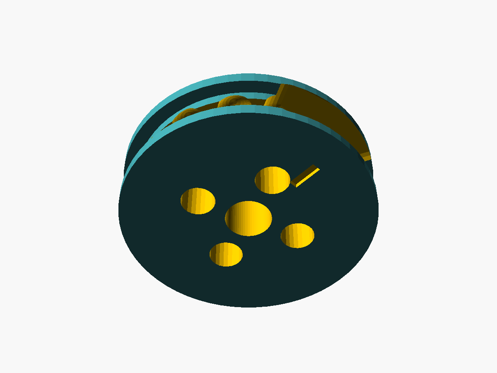

# メカ設計書：チェーン駆動ユニット（STS3215 + ボールチェーン）

Gemini で決めた方針（アシスト式・紐駆動・STS3215・ESP32・7.5V 電源）を、作れる形状と数値まで落とし込んだもの。
数値は `calc/winder_calc.py`、形状は `cad/winder.scad` から出している。`[要実測]` の値は実物を測ったら差し替える。

---

## 1. 方式の確定

| 項目 | Gemini 段階 | 本設計での確定内容 | 理由 |
|---|---|---|---|
| 駆動対象 | 紐（ループコード／チェーン） | 既製チェーン式ロールスクリーンの**ボールチェーン（玉径 4.5 / ピッチ 6.0）** | ロールスクリーン用樹脂ボールチェーンで最も一般的な規格（製品によって違うので要実測）。凹凸でかみ合うので滑らない |
| 駆動輪 | 溝付きプーリー φ40〜50 + 押さえローラー | **14 歯ボールチェーン用スプロケット（PCD 26.96 mm）** | 歯でかみ合うので押さえローラーが要らない。滑らないので、エンコーダの値＝チェーン位置としてそのまま使える |
| 巻き掛け | 1.5 ターン巻き（キャプスタン方式） | **ループ下端で 180° 巻き掛け** | ループの U ターン部にユニットを置くだけで、ヘッド側は無改造 |
| 張り | バネ式テンショナー | **取付板の上下長穴（調整幅 20 mm）** | かみ合い式なので、たるみを取る程度の弱い張力で足りる |
| 外れ止め | — | **チェーンガード（すきま 1.0 mm）+ 着脱カバー** | 歯飛びには 3.6 mm 浮く必要があるが、ガードで 1.8 mm 以上浮かないようにしている（§4.3） |
| 停電時の手動操作 | アシスト式では電源が前提 | **カバーを外してチェーンを外せば既製品どおり手で操作できる** | 1:345 ギアを手で逆転させるのは重い可能性があり、ギアも傷めやすい（重さは試験 T8 で確認） |

### 1.1 全体配置

正面図（室内から見る）

```
 +------------------------------+-+   <- ヘッドボックス（右端にチェーンホイール）
 |                              | |
 |                              |||   <- ボールチェーンのループ（2本）
 |      screen 1.8 x 2.0 m      |||
 |                              |||
 |                              +++
 |                             [=o=]  <- 駆動ユニット（壁・窓枠に木ねじ止め）
 +------------------------------+     <- ウエイトバー
```

側面図（窓の幅方向から見る。左が壁）

```
  wall  head
   |   +-----+
   |   |  o  |     <- ヘッドのチェーンホイール
   |   +-+-+-+
   |     | |      <- チェーン2本（奥 = 下げ側 / 手前 = 上げ側）
   |     | |
   |     | |      <- S = ヘッド〜ユニット間。S >= L/2 + 0.1 m
   |  +--+-+--+
   |==|  (o)  |   <- 駆動ユニット（スプロケットを下から U 字に巻き掛け）
   |  +-------+
   |<-y_c->|      <- 取付面からチェーン中心まで（既定 45 mm）
```

- ユニットは**壁（窓と平行な面）に取り付ける**。スプロケット軸はローラーと平行（窓の幅方向）にする。
  チェーンの 2 本は「奥／手前」に並んで垂れているので、スプロケットもその面内で回す必要がある。
- サーボ本体はスプロケットの横（窓の幅方向）に置く。チェーンの通り道と重ならない。
- 天井付けで窓枠の内側にチェーンが垂れる場合は、窓枠の側面に付ける「側面付け」版が必要（§8 未決事項）。


---

## 2. 負荷計算

### 2.1 モデル

- 吊り下げ質量：生地 1.8 × 2.0 m × 0.35 kg/m²（遮光生地）= 1.26 kg、ウエイトバー 0.4 kg、合計 **1.66 kg**
  （参考：TOSO チェーン式 2.0 × 2.0 m の製品重量はヘッド・パイプ込みで 3.4 kg）
- 巻き径 `d(x) = √(d_pipe² + 4·t·(H − x)/π)`：パイプ φ32 → 全開時 φ47.9（生地厚 0.5 mm）
- ローラー軸トルク `τ(x) = g · (m_bar + m_cloth·x/H) · d(x)/2`（x = 垂れ下がり長さ）
- チェーン力 `F = τ / (D_cw/2) / η`（D_cw = ヘッド側チェーンホイール PCD 38 mm と仮定、η = 0.7）
- 最大になるのは**全閉（一番下）から巻き上げ始めるとき**（垂れ下がりが最大で巻き径が最小）

| 項目 | 値 |
|---|---|
| 上げ方向 最大チェーン力 F_up | 19.6 N（推定） |
| 設計チェーン力（× 1.4） | **27.4 N** |
| 下げ方向 チェーン力 F_down | 8 N（仮定：ヘッドのブレーキを外す力。重力が助ける） |
| 全行程のチェーン移動量 L | **1.90 m**（`∫ D_cw / d(x) dx`） |

> 上の値はすべて推定。**F_up と L は吊りはかりとメジャーで実測できる**（[build_and_test.md](build_and_test.md) §1）。
> 実測したら `python3 calc/winder_calc.py --f-up <N> --travel <m>` で再計算する。

### 2.2 スプロケット歯数の選定

STS3215-C001（7.4 V、1:345）：ストール 19.5 kg·cm、無負荷 52 rpm（Feetech データシート）。
連続運転はストールの 25% 以下を目安とする。

| 歯数 | PCD [mm] | 送り [mm/rev] | 設計トルク [kg·cm] | ストール比 | 負荷時 [rpm] | 上げ時間 [s] | 行程の回転数 |
|---:|---:|---:|---:|---:|---:|---:|---:|
| 10 | 19.4 | 60 | 2.71 | 14% | 45 | 53 | 31.7 |
| 12 | 23.2 | 72 | 3.24 | 17% | 43 | 46 | 26.4 |
| **14** | **27.0** | **84** | **3.77** | **19%** | **42** | **40** | **22.6** |
| 16 | 30.8 | 96 | 4.30 | 22% | 41 | 37 | 19.8 |
| 18 | 34.6 | 108 | 4.83 | 25% | 39 | 34 | 17.6 |
| 20 | 38.4 | 120 | 5.36 | 27% ⚠ | 38 | 32 | 15.8 |

上げ時間は「負荷時回転数の 80% で指令」したときの値（速度制御に余裕を残すため）。

**採用：14 歯**（PCD 26.96 mm、1 回転 84 mm、エンコーダ 1 step = 0.0205 mm）

- 設計トルク 3.77 kg·cm（0.37 N·m）＝ストールの 19%。発熱・音・ギア寿命の面で余裕がある
- 全行程 約 40 秒（34 rpm ≒ Goal Speed 2290 step/s）。チェーン速度 47 mm/s
- 行程はサーボ 22.6 回転。サーボの多回転モード（±7 回転）では足りないので、**速度モードで回し、回転数は ESP32 側で数える**（§6）
- ボールチェーンはピッチが 6 mm で決まっているので、径は歯数ごとの飛び飛びの値しか選べない

**歯数の変更ルール**（実測後）：

- 実測 F_up が **25 N を超える** → 12 歯に変更（`n_teeth = 12`）
- 実測 F_up が **15 N 未満** で速くしたい → 16 歯に変更
- 歯数を変えても他の寸法は自動で追従する（`cad/winder.scad` の `n_teeth`）

### 2.3 Gemini 試算との差分

| 項目 | Gemini | 本設計 | 補足 |
|---|---|---|---|
| STS3215 無負荷回転数 | 62 rpm（0.16 s/60°） | 52 rpm @7.4V | Feetech データシート「52RPM@7.4V」に合わせた。所要時間はやや長くなる |
| 駆動輪径 | φ40〜50 プーリー | PCD 27 mm スプロケット | 半径が小さいぶんトルクに余裕が出る（同じ力で約 0.6 倍） |
| 所要時間 | 20〜40 秒 | 約 40 秒 | 推定値。実測した F_up と L で再計算する |
| 押さえローラー | 必須 | 不要 | かみ合い式にしたため |

---

## 3. スプロケット

`cad/stl/sprocket.stl`（前面を下にして造形）



| 部位 | 寸法 | 決め方 |
|---|---|---|
| 歯数 / PCD | 14 / 26.96 mm | PCD = p / sin(180°/N)。ボール中心がこの円の上に乗る |
| ポケット | 球 φ4.9（ボール φ4.5 + 0.4） | 造形誤差とチェーンのばらつきを吸収 |
| 歯先半径 | 14.83 mm（PCD/2 + 0.3·玉径） | ボールが中心より 1.35 mm 深く入り、接線方向に抜けない |
| 芯ひも溝 | 幅 2.4 mm、底半径 11.84 mm | ボール間の芯ひも（φ1.8）が弦になって通る位置より 0.4 mm 下げた |
| フランジ | 外半径 16.53 mm、厚 1.6 mm（両側） | チェーンを横方向に外さない |
| チェーン部全幅 | 8.3 mm | |
| ハブ | φ23、長さ 4.5 mm | 背面壁（仕切り）を通ってホーンに当たる |
| ホーン固定 | ねじ 4 本（PCD 14）+ 外径 φ20 の位置決め座ぐり 1 mm | **[要実測]** ホーンの外径・ねじ穴ピッチ・ねじ径（M2/M3） |
| 中心穴 | φ6 | ホーンの中心ねじに工具を通す |

### 3.1 チェーンジョイントの逃げ（重要）

ループをつないでいる**チェーンジョイントは、全行程のどこかで必ずスプロケットかヘッドのホイールを通過する**。

- 1 点のチェーンは全行程で L ≈ 1.9 m 動く
- ヘッド〜ユニット間の片側の長さ S はふつう 1〜1.3 m なので、どこに置いても 1.9 m 動けば端のホイールに当たる
- ヘッド側ホイールにジョイントを通すと引っかかるおそれがあるので、**ユニット側のスプロケットを通す**ことにする

そのため、スプロケットの 3 ポケット分（`joint_span = 2`）を 1 本の溝にした「ジョイント逃げ」を設けた（断面図の左下の直線部分）。

- かみ合い式で滑らないので、**ボール k 番目は毎回同じポケットに入る**。最初にジョイントを逃げ溝に合わせて掛ければ、以後もずっと逃げ溝に入る
- 前面の**合わせマーク**（刻み線）が逃げ溝の位置を示す
- 逃げ溝がかみ合い範囲（180° = 7 ポケット）に来ても、4 ポケット以上がかみ合っているので駆動力は足りる
- 条件：**S ≥ L/2 + 0.1 m**（ジョイントがヘッドまで上がらないように）。L = 1.9 m なら S ≥ 1.05 m
- ジョイントの寸法は **[要実測]**（`joint_d`, `joint_span`）。φ5.2 × ボール 3 個分の長さを想定


*チェーン中心面の断面。左が壁。青＝ハウジング、橙＝スプロケット（芯ひも溝の底）、黒＝チェーン。*


*芯ひも溝の外側（中心から 1.5 mm）の断面。ボールがポケットに入っていることを確認するための図。*

### 3.2 下限コネクタ（逆巻き防止ストッパー）の扱い

既製品のボールチェーンに付いている**下限コネクタ（大きめのストッパー）はスプロケットを通過できないので外す**。

- 同じ理由で、ストッパーを付けてよい位置がチェーン上にない（S ≥ L が必要だが、そこまでヘッドから離せない）
- 代わりに**下限はソフトウェアで止める**：上限で原点出し → 教示した行程で停止（§6）
- 上限は既製品と同じく、ウエイトバーがヘッドに当たって止まる（これを原点出しに使う）

---

## 4. ハウジング

`cad/stl/housing.stl`（取付板を下にして造形）、`cover.stl`、`cap.stl`


### 4.1 構成

| 部位 | 内容 |
|---|---|
| 取付板 | 厚 4 mm、約 76 × 104 mm。上下方向の長穴 3 か所（φ4.5 × 調整幅 20 mm）で木ねじ止め。長穴でチェーンの張りを調整する |
| サーボスリーブ | STS3215（45.2 × 24.7 × 35）をすきま 0.3 mm で収める箱。出力軸側は壁寄りの端だけケース上面に当てる（ホーンの回転域は空けてある） |
| 後端キャップ | M3 タッピング 2 本でサーボを押さえる。中央は配線を出すために大きく開けてある |
| 背面壁 | サーボとスプロケットの仕切り。ハブが通る穴 φ25 |
| チェーンガード | スプロケット下半分とチェーン 2 本の入口を囲む U 字の溝。内半径 17.53 mm（フランジ + 1.0 mm）、壁厚 4.5 mm |
| カバー | +X 側のふた。M3 タッピング 3 本。外すとチェーンを掛け外しできる。中央の窓から合わせマークが見える |

### 4.2 主要寸法（既定値）

| 寸法 | 値 | パラメータ |
|---|---|---|
| 取付面からチェーン中心まで | 45 mm **[要実測]** | `y_c` |
| スプロケット中心からガード上端まで | 40 mm | `z_top` |
| サーボ出力軸から近い側のケース端まで | 11.5 mm **[要実測]** | `srv_e` |
| ケース上面からホーン上面まで | 5.5 mm **[要実測]** | `horn_stack` |
| ユニット外形（幅 × 高さ × 奥行） | 約 76 × 104 × 67 mm | |

### 4.3 外れ止めの確認

- ボール外端：13.48 + 2.25 = 15.73 mm
- ガード内周：17.53 mm → ボールが浮けるのは最大 **1.80 mm**
- 歯飛びに必要な浮き：歯先 14.83 −（ボール下端 11.23）= **3.60 mm**
- → ガードがある限り歯飛びしない。チェーンがたるんでいても外れない

### 4.4 造形条件（推奨）

| 部品 | 材料 | 向き | 設定 |
|---|---|---|---|
| sprocket | PETG または ASA | 前面（ねじ頭側）を下 | 0.12〜0.16 mm ピッチ、外周 4 層、充填 60% 以上（歯の強度） |
| housing | PETG / ASA | 取付板を下 | 0.2 mm、外周 4 層、充填 30〜40%。サポートはハブ穴まわりのみ |
| cover / cap | PETG / ASA / PLA | 平置き | 0.2 mm |

窓際は夏に 50℃ を超えることがあるので **PLA はスプロケットとハウジングに使わない**。

---

## 5. 設置と調整

1. ヘッドのチェーンホイールの真下、チェーン 2 本の中間にスプロケットが来る位置を決める
   - 高さ：**ヘッドから S ≥ L/2 + 0.1 m 下**（L = 1.9 m なら 1.05 m 以上）。かつ子どもの手が届きにくい高さ
   - 奥行：取付面からチェーン中心までの距離を測り `y_c` に入れて再出力する
2. 下限コネクタを外す。チェーンジョイントは「全行程の中ほどでユニット付近にある」位置に移しておく
3. カバーを外し、チェーンを下から U 字に掛ける。**ジョイントを合わせマークの逃げ溝に入れる**
4. ユニットを長穴の上側で仮止め → 下に引いて、チェーン 2 本がまっすぐになる程度（手で押して 5〜10 mm たわむ程度）で本締め
   - 張りすぎるとヘッドのブレーキとサーボ軸に余計な荷重がかかる。かみ合い式なので強い張力は要らない
5. カバーを付ける

---

## 6. 制御側への要求（巻き取りの動かし方）

メカの都合で決まる制御仕様。ファームウェア実装時の前提にする。

### 6.1 運転モード

| 状態 | サーボ設定 | 内容 |
|---|---|---|
| 待機 | **トルク OFF**（Torque Enable = 0） | カーテンはヘッドのブレーキで止まっているので、保持トルクは要らない。トルク OFF でも位置は読める |
| 移動 | 速度モード（Mode 1、`WheelMode()`）、Goal Speed ±2290 step/s、加速度は 0.5 秒程度で最高速になる値 | 止めるときは速度 0 → 停止を確認 → トルク OFF |
| 原点出し | 開ループ PWM モード（Mode 2）、デューティ 35% | 上げ方向に回し、ウエイトバーがヘッドに当たって止まったことを検出する |

> **注意：Torque Limit（トルク制限）で力の上限を作らない。**
> データシートでは負荷値（Present Load）は「モーターに掛ける PWM デューティ（1000 = 100%）」。
> トルク制限も同じデューティの上限として働くと考えられ、25% に絞ると 34 rpm に必要なデューティ（約 80%）に届かず、
> 無負荷でも 13 rpm 程度しか出なくなるおそれがある（実機で要確認）。
> そこで力の上限は ① 原点出しでは開ループ PWM のデューティ、② 通常運転では電流監視、で作る。

### 6.2 位置管理（多回転）

- Present Position（0〜4095）を 50 Hz で読み、前回との差が ±2048 を超えたら 1 周またいだとみなして累積する
- 50 Hz なら運転中の 1 周期の移動は約 46 step。人がチェーンを 1 m/s で引いても約 1000 step なので取りこぼさない
- 電源を切ると回転数は消える（サーボは 1 回転内の角度しか覚えていない）
  - 停止のたびに累積位置を ESP32 の不揮発メモリ（NVS）に保存する
  - 起動時、保存した位置の 1 回転内の角度と、いまの角度が ±20 step 以内で一致すれば保存値を使う
  - 一致しなければ（電源断中に手で動かされた）、**次の操作の前に原点出しをする**

### 6.3 原点・リミット

| 項目 | 方法 |
|---|---|
| 上限（原点） | Mode 2・デューティ 35% で上げる。ロックしてもチェーン力は 約 50 N（理論値）で頭打ちになる。速度が 0 付近のまま 300 ms 続いたら停止 → 原点 = 0 |
| 原点出しの時間 | 全閉から始めると最長 約 2 分（11 rpm）。上の方からなら数秒。めったに行わない前提 |
| 下限 | 原点から教示した行程（初期値 92,700 step = 1.9 m）。手前 50 mm（約 2,400 step）から減速 |
| 通常運転の力の上限 | Present Current（1 = 6.5 mA）を監視し、**全閉からの巻き上げで実測した最大電流の 1.5 倍**を 100 ms 超えたら停止 |
| 逆巻き防止 | 下限はソフトリミットのみ。**位置が確定するまで（原点出し or 保存値の照合が済むまで）下げ方向の移動を禁止** |

Mode 2 のデューティとロック時の最大チェーン力（14 歯の場合、`winder_calc.py` 出力）：

| デューティ | ロック時の最大チェーン力 | 全閉からの原点出し |
|---:|---:|---:|
| 30% | 43 N | 8 rpm・最長 161 秒 |
| **35%** | **50 N** | **11 rpm・最長 123 秒** |
| 40% | 57 N | 14 rpm・最長 100 秒 |

### 6.4 アシスト（手で引いたときの検出）

| 判定 | 条件（初期値。試験で調整） |
|---|---|
| 動き出し | 待機中に位置が 250 step（約 5 mm）以上変わった → 変わった向きに自動運転を開始 |
| 手で止める | 運転中に Present Load が直近平均より **150 以上増えた**（逆らう向きの力）状態が 100 ms 続いた／速度が指令の 50% 未満になった → 停止 |
| ずっと引いている | 同じ向きに引かれると負荷は**下がる**だけなので、停止判定には使わず運転を続ける |

- 1 step = 0.0205 mm と細かいので、5 mm の判定でも十分に余裕がある
- 待機中の誤検出（振動・風）は「250 step を 0.5 秒以内に」のように時間条件を付けて防ぐ

### 6.5 保護

- 温度 60℃ 超・電圧 6.5 V 未満・予定時間の 1.5 倍を超えた → 停止して異常を通知
- サーボ内部にも過負荷保護がある（ロックが続くと自動でトルクを抜く）

---

## 7. 安全

- **ループチェーンは乳幼児の首に絡まる事故の原因になる**。ユニットがループを壁に固定するので、既製品の「チェーン固定具」と同じ役目になる。チェーンをユニットから外したまま放置しない
- 通常運転は電流監視と速度低下で止める。原点出しは開ループ PWM 35% にして、ロックしてもチェーン力が 約 50 N を超えないようにする
- 電流監視でどこまで力を抑えられるか（止まるまでに出る最大の力）は、試作で吊りはかりを使って確認する（[build_and_test.md](build_and_test.md) §5）
- スプロケットはカバーで覆い、指が入らないようにする
- ヘッド側のチェーンジョイントが安全分離型の場合、原点出しの力で外れることがある。外れたら原点出しのデューティを下げる（30% → 約 43 N）

---

## 8. 未決事項

| # | 内容 | 決め方 |
|---|---|---|
| 1 | 取付方向（正面付け／窓枠側面付け） | 実際の窓でチェーンの垂れ位置を確認する。側面付けならサーボ後端側を取付板にした別形状を作る |
| 2 | ホーンのねじ穴（径・ピッチ）、出力軸位置 `srv_e`、`horn_stack` | STS3215 の実物を測る |
| 3 | チェーンジョイントの形・寸法、ヘッド側ホイールを通れるか | 実物を測る。逃げ溝が合わなければ `joint_d` / `joint_span` を変える |
| 4 | F_up・F_down・L の実測値 → 歯数の最終決定 | [build_and_test.md](build_and_test.md) §1 の手順で測る |
| 5 | 電源停止時にサーボを手で逆転できるか（重さ） | 試作で確認。重ければ「停電時はチェーンを外す」運用にする |
