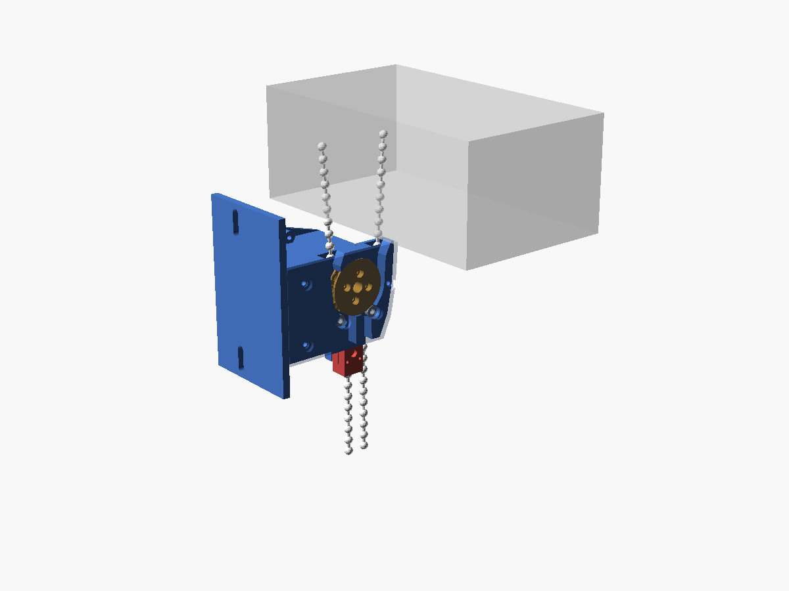
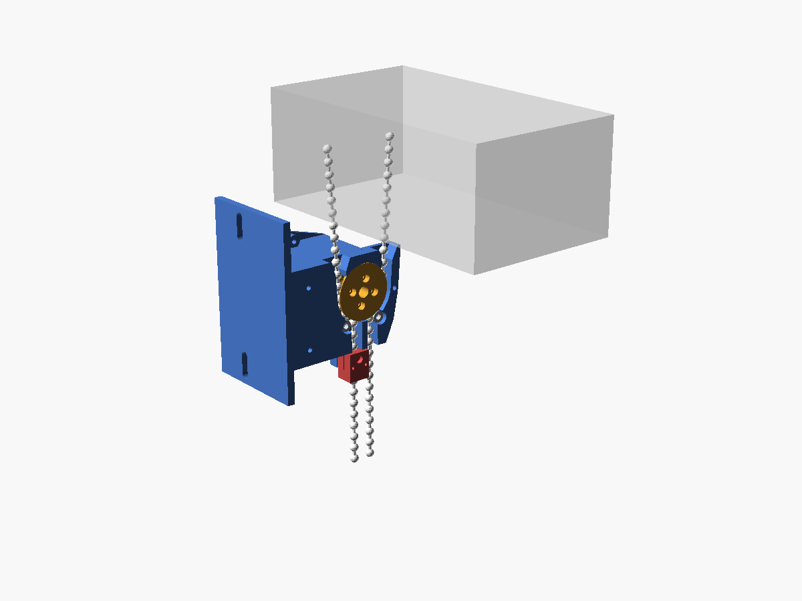
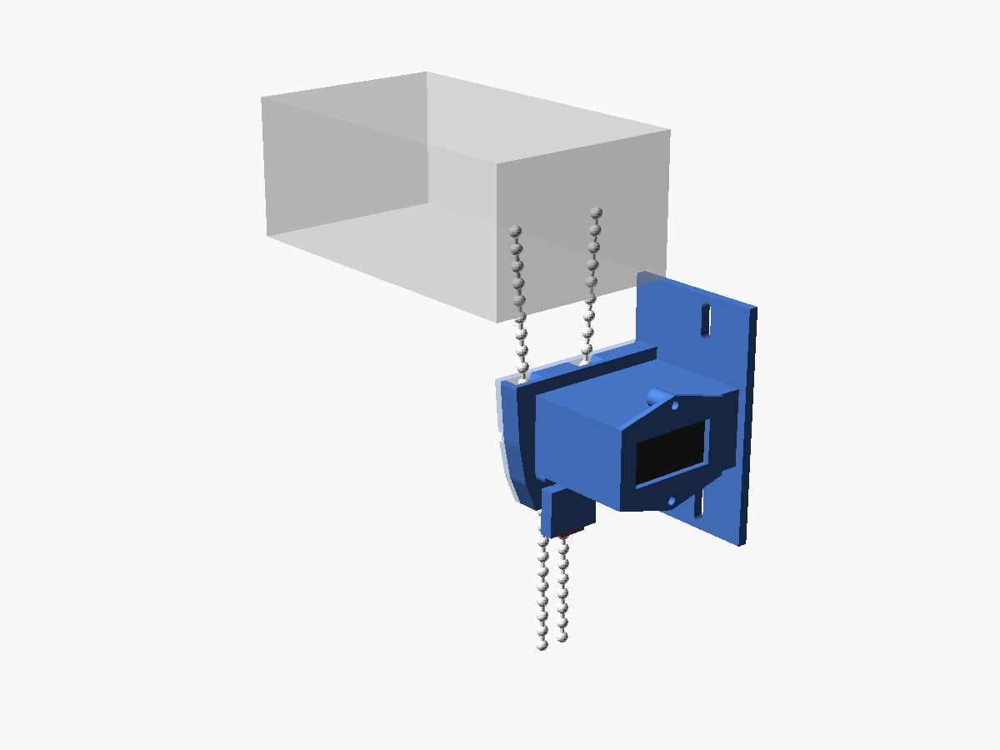

# メカ設計書 v2：ロール直下取付・チェーン 2 本挟み込み式

v1（チェーンループの下端に付ける方式）から、次の要件を反映して作り直した。

| 要件 | v1 | v2（本書） |
|---|---|---|
| 取付位置 | ループの下端（床から約 1 m） | **ロール直下**（ヘッドボックスの下 約 30 mm）。目立ちにくい |
| チェーンのつなぎ目 | スプロケットに逃げ溝 | **つなぎ目なし（連続ループ）なので逃げ溝は削除** |
| 手での操作 | 停電時にチェーンを外して操作 | **ユニットを付けたまま、いつでも手で引いて巻き取れる** |
| 原位置 | 上限で負荷が上がるのを検出 | **巻き上げてストップする位置**。チェーンに付けたストッパーがユニット下面に当たる位置を原位置とし、センサーで検出 |

数値は `calc/winder_calc.py`、形状は `cad/winder.scad` で作っている。`[要実測]` の値は実物を測ったら差し替える。

---

## 1. 方式

### 1.1 2 本のチェーンを両方つかむ

ユニットをロール直下に付けると、ユニットより下のチェーンループは**どこにも固定されずに垂れたまま**になる（手で引けるようにするため）。

- チェーンは引くことはできても押すことはできない。片方のチェーンだけをつかむと、そのチェーンをヘッドへ引き下ろす一方向にしか動かせない
- そこで**ヘッドから垂れる 2 本のチェーンの間にスプロケットを置き、両方にかみ合わせる**。2 本目のチェーンホイールのように働き、片方向に回すと手前のチェーンを引き下ろし（上げ）、逆に回すと奥のチェーンを引き下ろす（下げ）
- ヘッドに向かうチェーンが張り側、下のループに出ていく側はたるみ側になる。下のループは重力で垂れているだけなので、引っぱったり固定したりする部品は要らない

### 1.2 ピンチローラーを外側に置く

ヘッドから真下に垂れてきたチェーンは、そのままではスプロケットに点でしか触れない。そこで、**各チェーンの外側、スプロケットの斜め下（水平から 57°）にピンチローラーを置き**、チェーンをスプロケットに押し付けてから真下に戻す。

- 巻き掛け角は約 **53°**（約 2 ポケット）。ローラーの位置で最後のボールをポケットに押し込むので歯飛びしない
- ローラーはチェーンをスプロケットから引きはがす役も兼ねる（ポケットに残ったボールをローラー側へ送り出す）
- ローラーを 2 本のチェーンの**内側**に置いても巻き掛けは作れない。張ったチェーンは支えのある側にしか曲がらず、内側のローラーではスプロケットで内向きに曲がったチェーンを真下に戻せないため（作図で確認した）

### 1.3 構成

側面図（窓の幅方向から見る。左が壁）

```
        +---------------------+
        |   (  head wheel  )  |   <- ヘッドボックス（チェーンホイール）
        +-----|---------|-----+
              |         |          head_gap = 30 mm
         +----\---------/----+  <- ユニット上面（入口）
         |     \  ___  /     |
         |      |( O )|      |  <- スプロケット（2 本の間）
         |   o  /     \  o   |  <- ピンチローラー（外側、57°）
         +-----| |---| |-----+  <- ユニット下面（ストッパーが当たる面）
              [#]  | |           <- 上限ストッパー（奥のチェーン）
               |   | |
               |   | |           <- 下のループは自由に垂れる（手で引ける）
```


*チェーン中心面の断面。左が取付面。青＝ハウジング、橙＝スプロケット（歯の面）、灰＝ピンチローラー、黒＝チェーン、赤＝上限ストッパー（原位置で当たった状態）。*



- サーボは**窓の外側（ヘッドボックスの端より外）**に置く。スクリーン側にはカバー（厚さ 3 mm）しか出ないので、チェーン面からスクリーン端まで 7.2 mm あればよい
- ユニット外形：幅（窓の幅方向）約 57 mm × 奥行（取付面から）約 76 mm × 高さ 本体 50 mm（取付板 92 mm）




---

## 2. 負荷・トルク

負荷の推定は v1 と同じ（吊り下げ 1.66 kg、上げ方向の最大チェーン力 19.6 N、全行程のチェーン移動量 1.9 m）。
v2 ではローラーとガイドの損失（効率 0.95）を足し、設計チェーン力は **28.9 N**（× 1.4）。

| 歯数 | PCD [mm] | 巻き掛け | かみ合い | 設計トルク [kg·cm] | C001 ストール比 | C001 上げ時間 | ユニット下の 2 本の間隔 |
|---:|---:|---:|---:|---:|---:|---:|---:|
| 12 | 23.2 | 51° | 1.7 ポケット | 3.41 | 17% | 46 s | 8.1 mm |
| **14** | **27.0** | **53°** | **2.1 ポケット** | **3.97** | **20%** | **41 s** | **10.1 mm** |
| 16 | 30.8 | 54° | 2.4 ポケット | 4.53 | 23% | 37 s | 12.2 mm |
| 18 | 34.6 | 56° | 2.8 ポケット | 5.08 | 26% | 34 s | 14.3 mm |

**採用：14 歯**（巻き掛け 2 ポケット以上を確保でき、ユニット下の 2 本が 10 mm 離れて手で選びやすい）

### 2.1 サーボの版（手での操作を前提にしたため再検討）

| 版 | 減速比 | ストール | 無負荷 | 14 歯での設計トルク比 | 全行程 | 手で回すとき |
|---|---:|---:|---:|---:|---:|---|
| **STS3215-C001**（現行） | 1:345 | 19.5 kg·cm | 52 rpm | 20% | 41 s | 重い（減速比が大きい） |
| STS3215-C046 | 1:147 | 14.4 kg·cm | 106 rpm | 28% | 22 s | C001 より軽いはず |

- **C001 のまま進める**。ただし、トルク OFF で手で回したときの重さ（逆駆動トルク T_bd）を最初に測る（[build_and_test.md](build_and_test.md) T0）
- 手で引く力は `既製品の力 + T_bd / 13.5 mm`。T_bd = 0.2 N·m なら 35 N（3.6 kgf、既製品だけなら 2.0 kgf）
- **全閉から上げ始める力が 35 N を超える場合**は、C046 に替えるか、制御側で「手で引いた動きを検出してモーターが追従する」アシストで補う（制御フェーズで検討）
- C046 は定格トルク 4.8 kg·cm に対し設計トルク 3.97 kg·cm。連続 25% の目安はやや超えるが、1 回 20 秒程度の運転なら使える範囲

---

## 3. スプロケット（`stl/sprocket.stl`）

| 部位 | 寸法 | 備考 |
|---|---|---|
| 歯数 / PCD | 14 / 26.96 mm | |
| ポケット | 球 φ4.9 | ボール φ4.5 + 0.4 |
| 歯先半径 | 14.83 mm | |
| 芯ひも溝 | 幅 2.4 mm、底半径 11.84 mm | |
| チェーン部の幅 | 5.1 mm | **フランジなし**（左右の外れ止めは背面壁とカバーで行う。ローラー軸をスプロケットの近くに置くため） |
| ハブ | φ23 × 4.5 mm | |
| ホーン固定 | ねじ 4 本（PCD 14）+ φ20 の位置決め座ぐり | **[要実測]** |
| 逃げ溝 | なし | つなぎ目のない連続ループのため削除 |

---

## 4. ピンチローラー

| 項目 | 値 |
|---|---|
| ローラー | ミニチュア軸受 **MR63ZZ**（内径 3 × 外径 6 × 幅 2.5）を 2 個。外輪がそのまま転がる |
| 位置 | スプロケット中心から 18.93 mm、水平から下 57°（左右対称） |
| ボールを挟むすきま | 0.2 mm |
| 歯先とのすきま | 1.10 mm |
| 軸 | M3 × 16 なべ／ボタンボルト。カバー側から差し、軸受を通して背面壁のボスにねじ込む |
| 左右位置 | カバーと背面壁の内側にある φ4 のスペーサー（各 1.9 mm）で軸受をチェーン中心面に置く |

---

## 5. ハウジング（`stl/housing.stl`, `cover.stl`, `cap.stl`）

| 部位 | 内容 |
|---|---|
| 入口（上面） | ヘッドから下りてくる 2 本を受ける漏斗形。左右それぞれ ±3 mm のずれを吸収 |
| 通路 | ボール外端から 1.0 mm のすきまでチェーンを囲む。巻き掛け部では、ボールが 3.6 mm 浮かないと歯飛びしないのに対し 1.0 mm しか浮けない |
| はぎ取り部 | スプロケットの真上と真下（チェーンが掛からない範囲）は、歯先 + 0.4 mm まで壁が迫っている。ポケットに残ったボールはここで外れる |
| 出口（下面） | 2 本のチェーン（中心から ±5.06 mm）を真下に出す穴。下面はストッパーが当たる面 |
| 背面壁・サーボスリーブ・後端キャップ | v1 と同じ。サーボは外側（-X）に置く |
| センサー台 | 下面の外側に張り出した台。ホール IC 用のポケット 2 個（上限用＝奥、下限用＝手前） |
| カバー | スクリーン側。M3 × 10 タッピング 3 本 + ローラー軸 2 本で固定 |
| 取付板 | 厚 4 mm、上下の長穴 2 か所（±5 mm の位置合わせ）。張り調整は不要になった |

`[要実測]` の取付寸法：

| 寸法 | 既定値 | パラメータ |
|---|---|---|
| 取付面から、ヘッドの 2 本のチェーンの中間まで | 50 mm | `y_c` |
| ヘッドから垂れる 2 本の中心間距離の 1/2 | 19 mm | `s_head` |
| ヘッドボックス下面からチェーンホイール中心まで | 25 mm | `head_drop` |
| チェーン面からスクリーン（ウエイトバー）端まで | 12 mm（7.2 mm 以上必要） | `x_screen` |

---

## 6. 原位置（上限）と下限

### 6.1 仕組み

- **原位置 = 巻き上げてストップする位置**。奥のチェーン（上げるときに上へ動く側）に**上限ストッパー**をはさみ、全開でユニット下面に当たって止まるようにする
- ストッパーは 2 つ割りの樹脂ブロック（10 × 12 × 15 mm、`stl/stopper.stl`）で、ボール 2 個をはさんで M2 ねじ 2 本で締める。左右の面に φ4 × 2 の磁石を入れる
- ユニット下面の外側にあるセンサー台のホール IC が、当たったストッパーの磁石を検出する（磁石とのすきま 約 1.4 mm）
- **モーターで巻き上げたときも、手で巻き上げたときも同じように検出できる**。電源を切っている間に手で動かされても、次に巻き上げきったときに原位置が取り直される
- ストッパーは、ウエイトバーがヘッドボックスに当たる **5〜10 mm 手前**で当たる位置に付ける（ヘッドを叩かないため）

### 6.2 下限

- 手前のチェーン（下げるときに上へ動く側）に同じストッパーを付ければ、全閉で同じように止まり、もう 1 つのホール IC で検出できる
- 手で下げすぎても機械的に止まるので、**逆巻き（下ろしすぎてスクリーンが反対向きに巻かれる）を手動でも防げる**
- 既製品の下限コネクタ（付いていれば）は、ヘッドではなくユニット下面に当たるようになり位置が変わるので、外してこのストッパーに置き換える

### 6.3 条件

- ストッパーは全行程で L（約 1.9 m）動く。反対側の出口まで回り込まないよう、**ユニットより下のループの長さ（片側 × 2）≥ L + 0.2 m** が必要（標準のチェーン長なら満たす見込み。要確認）
- 「上げるときにどちらのチェーンが上へ動くか」は製品で逆の場合がある。取付前に確認する

---

## 7. 手での操作

- これまでどおり、**手前のチェーンを引けば上がり、奥を引けば下がる**（ループの向きは変わらない）。ユニット下の 2 本は 10 mm 離れて出てくる
- 引く力 = 既製品の力（19.6 N）÷ 0.95 + サーボの逆駆動トルク ÷ 13.5 mm（§2.1）
- 電源が入っていてトルク OFF なら、手で動かした量もエンコーダで数えられる（位置がずれない）
- 電源が切れていると回転数は数えられないが、次に巻き上げきったとき（§6）に原位置で取り直される
- それでも重すぎる・故障したときは、カバー（ねじ 3 本 + ローラー軸 2 本）を外してチェーンをユニットから抜けば、既製品の状態に戻る

---

## 8. 制御への引き継ぎ（メカから決まる条件）

詳細は制御フェーズで決める。メカ側の前提として次を渡す。

| 項目 | 内容 |
|---|---|
| 待機 | トルク OFF（カーテンはヘッドのブレーキで止まっている）。位置は読み続ける |
| 移動 | 速度モード（Mode 1）。C001 なら Goal Speed 約 2260 step/s（46 mm/s） |
| 位置 | 1 回転 = 84 mm = 4096 step。50 Hz で読み、±2048 を超える変化で 1 周として累積。全行程 約 22.6 回転 |
| 原位置 | 上限ホール IC が反応した位置 = 0。位置が不明なときは低速（通常の 1/3 程度）で上げて原位置を取る |
| 下限 | 下限ホール IC、または原位置から教示した行程 |
| 力の上限 | Torque Limit（トルク制限）は PWM デューティの上限として効くと考えられ、絞ると速度が出なくなるおそれがある（要実機確認）。電流（Present Current）の監視で止める |
| 手で引いたとき | トルク OFF で位置が変わったことを検出できる（1 step = 0.02 mm）。アシストにするかは制御フェーズで決める |

---

## 9. 安全

- ユニットより下のループは固定しないので、既製品と同じく**乳幼児が首を掛ける危険がある**。既製品付属のクリップでまとめる、子どもの手の届かない高さで使う、といった既製品と同じ注意が必要
- ユニット内部はカバーで覆い、スプロケットとローラーに指が入らないようにする
- ストッパーに当たって止まるときの力は電流監視で抑える。止まるまでに出る最大の力は試作で測る（[build_and_test.md](build_and_test.md) T5）

---

## 10. 未決事項

| # | 内容 | 決め方 |
|---|---|---|
| 1 | サーボの逆駆動トルク T_bd → C001 のままか C046 に替えるか | T0 で測る |
| 2 | `y_c` `s_head` `head_drop` `x_screen` | 実物を測る。`s_head` が大きく違うと巻き掛け角が変わる（calc で再計算） |
| 3 | 上げるときにどちらのチェーンが上へ動くか、ユニット下のループ長 | 実物で確認 |
| 4 | ホーンのねじ穴・`srv_e`・`horn_stack` | STS3215 の実物を測る |
| 5 | 天井付け（窓枠の内側）の場合の取付 | 窓枠側面とヘッド端のすきまにサーボが入らないため別形状が必要。必要になったら検討 |
| 6 | ボール 1 個あたりの負荷（巻き掛け 2 ポケットで 10〜15 N） | 試作で長時間運転し、ボールの抜け・変形がないか確認 |
